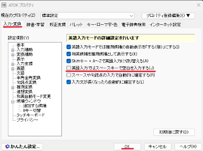
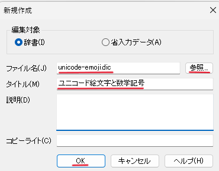
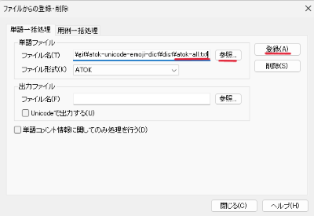
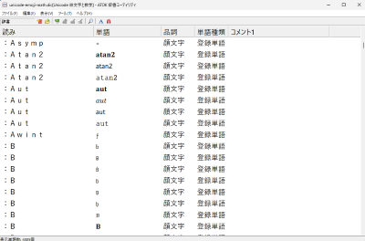
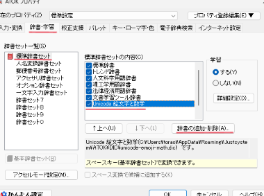

# ATOK Unicode 辞書

Unicode で利用可能な絵文字・数学記号・アクセント付き文字を ATOK を使って変換・入力するためのユーザ辞書です。

ATOK は `(^_^)` のような顔文字は変換できますが、`😀` `∑` `ℝ` `x²` `é` といった Unicode で利用可能な文字は通常の変換ではほとんど候補に出ません。この辞書を使用すると、コロンに続けて読みを打つことでこれらを変換できるようになります。

```text
:わらう    → 😀                  :Infty    → ∞            :E  → È É Ê Ë Ē …
:はーと    → ❤️ 💙 💚 💛 💜 …      :Leqslant → ⩽            :B  → 𝔹 ℬ 𝔅 𝐁 𝐵 …
:ゆびさし  → 👆 👇 👈 👉          :Alpha    → Α α 𝚨 𝛂 …    :^2 → ²
```

数学記号の変換には TeX のコマンド名を使うことができます。書体やアクセント、色、向きが違うだけの文字は、元の文字や名前を打って候補から選びます。

## インストール

### 1. 単語ファイルをダウンロードする

[Releases](../../releases) の最新版から必要な辞書ファイルをダウンロードします。

| ファイル | 内容 | 語数 |
| ----------------- | --- | --- |
| `atok-all.txt` | 下の 3 つをすべて含む | 4,305 |
| `atok-emoji.txt` | 絵文字 | 539 |
| `atok-math.txt` | 数学記号・技術記号・ギリシャ文字・数学用の書体・関数名 | 3,402 |
| `atok-accent.txt` | アクセント付きラテン文字 | 364 |

すべて使う場合は `atok-all.txt` をダウンロードしてください。絵文字だけ入力したい場合は `atok-emoji.txt` だけでも OK です。

### 2. ATOK の設定を変更する

英字入力は `:Infty` のように大文字で始めます。ATOK は大文字を打つと英語入力モードに切り替わり、初期設定ではスペースキーが変換ではなく空白の入力になります。

漢字変換にスペースキーを使用している人は、ATOK プロパティの [入力・変換] タブで [英語] を開き「英語入力ではスペースキーで空白を入力する」をオフにしてください。



普段から ATOK で英字入力を使っている場合は、この設定をオフにせず、他のキーを使って英字入力から変換するようにしてください。

### 3. 辞書を作って単語ファイルを取り込む

[辞書メンテナンス] → [辞書ユーティリティ] の［ファイル］→［新規作成］で、`unicode-emoji.dic` などの名前で新しい辞書を作ります。



新しい辞書の [ツール] → [ファイルから登録・削除] でダウンロードした `atok-*.txt` ファイルを選択して登録ボタンを押します。



これで新しい辞書ができあがりました。次はこの辞書を変換候補に加えます。



ATOK プロパティの［辞書・学習］タブで、辞書セット一覧から**標準辞書セット**を選び、[辞書の追加・削除］でいま作った辞書を追加します。



この手順では専用の辞書に登録したので、不要になったら辞書セットから外すだけで無効にできます。

### 変換できないとき

- 作った辞書を辞書ユーティリティで開き、語が入っているか確認してください。空の場合は手順 3 でダウンロードしたファイルを登録してください。
- 辞書を標準辞書セット以外 (辞書セット 7〜0 など) に追加した場合、スペースキーでは変換されません。標準辞書セットに追加するか、ATOK で辞書を切り替えて使用してください。
- 英語の大文字から始まる読みで変換時に空白が入力される場合は手順 2 の設定を確認してください。

## 使い方

ひらがな入力のまま、コロンキーに続けて読みを打ち、スペースキーで変換します。コロンは全角の `：` になります。

| 入力したいもの | 読み | 例 |
| --- | --- | --- |
| 絵文字 | ひらがなの呼び名 | `:わらう` → 😀、`:いいね` → 👍 |
| 記号 | TeX のコマンド名 | `:Infty` → ∞、`:Leqslant` → ⩽ |
| 記号 | 日本語の読み | `:そうわ` → ∑、`:むげんだい` → ∞ |
| 上付き・下付き | `^` か `_` に続けて文字 | `:^2` → ²、`:_I` → ᵢ |
| ギリシャ文字 | TeX のコマンド名 | `:Alpha` → Α α |
| 数学用の書体 | 元の文字 | `:B` → 𝔹 ℬ 𝔅 𝐁 … |
| アクセント付き文字 | 元の文字 | `:E` → È É Ê Ë … |
| 関数名 | Tex のコマンド名 | `:Sin` → 𝑠𝑖𝑛 𝐬𝐢𝐧 𝗌𝗂𝗇 𝚜𝚒𝚗 |
| 結合文字 | TeX のコマンド名 | X + `:Hat` → X̂ |

TeX のコマンド名やアクセント付き文字は、最初の英字だけを大文字にして入力します (`\infty` は `:Infty`、`\mapsto` は `:Mapsto`; 小文字で始めると ATOK がローマ字入力としてかなに変換してしまうためです)。大文字と小文字だけが違うコマンド名 (`\alpha` と `\Alpha` など) は同じ読みの候補として並びます。

書体・アクセント・色・向きだけが違う文字には、それぞれの読みを用意していません。`:はーと` で各色のハートが、`:B` で 13 書体の B が候補に並ぶので、そこから選びます。一度選んだ候補は、ATOK の学習によって次から上位に表示されます。

辞書に収録されていない絵文字を追加したり、変換の読みを変更したい場合は、辞書ユーティリティから単語の登録や編集で行ってください。

## 制約

- ATOK Passport for Windows / mac OS で動作を確認しています。ほかの製品や OS でも使えると思いますが確認はしていません。
- 半角英数入力モードでは変換できません。ATOK の仕様です。全角英数入力モードでの動作は確認していません。
- TeX のコマンドがすべてが使えるわけではありません。あくまで Unicode にある記号や文字の組み合わせで表現できるものだけです。
- 全部入りの辞書では、母音の読みの候補が 50 個を超えます (`:O` は 58 個)。数学用の書体と アクセントの候補が同じ読みに並ぶためです。気になる場合は `atok-math.txt` と `atok-accent.txt` のどちらかだけを取り込んでください。
- 肌の色や性別を組み合わせた絵文字 (ZWJ シーケンス) は収録していません。
- 数学用の書体の文字は、表示するフォントによっては □ になります。また結合文字も □ になったり正しく表示されないものも含みます。
- ATOK Passport の ATOK Sync One は、初期設定でユーザー作成辞書も同期します。 ほかの端末に同期したくない場合は、取り込む前に同期の設定を確認してください。

## 収録内容

### 絵文字

306 字の絵文字をひらがなの呼び名で変換できます。呼び方が複数ある絵文字には、それぞれの読みを用意しています (😀 は `:わらう` `:にこにこ` `:えがお`)。色や向きだけが違う絵文字は 1 つの読みにまとめています。

| 読み | 候補 |
| --- | --- |
| `:はーと` | ❤️ 💓 💖 💙 💚 💛 💜 🖤 🤍 |
| `:ゆびさし` | 👆 👇 👈 👉 |
| `:ぐらふ` | 📈 📉 📊 |
| `:かぎ` | 🔐 🔑 🔒 🔓 |

### 数学記号

| 種類 | 内容 | 例 |
| --- | --- | --- |
| TeX の記号 | LaTeX と AMS のコマンド名 (約 1,500) | `:Sum` ∑、`:Subseteq` ⊆、`:Forall` ∀、`:Mapsto` ↦ |
| 日本語の読み | よく使う演算子・関係・矢印・単位・技術記号・図形 | `:せきぶん` ∫、`:ならば` ⇒、`:まる` ● ○ ◎ ◯ |
| 上付き・下付き | 数字・英字・ギリシャ文字・`+` `-` `=` | `:^-1` ⁻¹、`:^T` ᵀ ᵗ、`:_N` ₙ |
| ギリシャ文字 | 24 字の大文字と小文字、異体字 | `:Lambda` Λ λ、`:Varepsilon` ε ϵ |
| 数学用の書体 | 英字・数字・ギリシャ文字の 13 書体 | `:R` ℝ ℛ ℜ 𝐑 …、`:1` 𝟙 𝟏 … |
| 関数名 | `\sin` `\lim` `\det` や `argmax` `softmax` など 119 語 | `:Argmax` 𝑎𝑟𝑔𝑚𝑎𝑥 𝑎𝑟𝑔 𝑚𝑎𝑥 … |

数学用の書体は、二重線体・筆記体・太字筆記体・ひげ文字・太字ひげ文字・太字・斜体・太字斜体・サンセリフ・サンセリフ太字・サンセリフ斜体・サンセリフ太字斜体・等幅の 13 種です。数字とギリシャ文字は、Unicode に文字がある書体だけを収録しています。

### アクセント付き文字

アクセント付きのラテン文字を、元の文字の読みで変換できます。

```text
:E → È É Ê Ë Ē Ĕ Ė Ę Ě …
:O → Ò Ó Ô Õ Ö Ø Ō Ő Œ …
```

フランス語・ドイツ語・北欧語・東欧語などで使うアクセントと、ベトナム語で使う符号を含みます。æ ß ð þ ŋ ə ı などの文字は、関係の深い文字の読みに入れています (æ は `:A`、ß は `:S`)。

### 結合文字

結合文字は、直前の文字に重ねて表示される記号です。単独では見えにくく、辞書ユーティリティで一覧を見ても判別しにくいため、利用できるものをここにすべて掲載します。読みは TeX のコマンド名と同じです。

先に元の文字を入力してから、結合文字を変換します (`x` に続けて `:Vec` で `x⃗`)。`:H` `:C` `:K` の 3 つは読みが 1 文字なので、数学用の書体やアクセント付き文字と同じ候補に並びます。

#### 文字の上に付くもの

| 読み | 例 | 名称 |
| --- | --- | --- |
| `:Grave` | x̀ | 抑音アクセント (グレーヴ) |
| `:Acute` | x́ | 鋭アクセント (アキュート) |
| `:Hat` | x̂ | サーカムフレックス (ハット) |
| `:Tilde` | x̃ | チルダ |
| `:Bar` | x̄ | マクロン |
| `:Overbar` | x̅ | 上線 |
| `:Breve` | x̆ | ブレーヴェ |
| `:Dot` | ẋ | 上のドット |
| `:Ddot` | ẍ | 上の 2 点 (ウムラウト) |
| `:Ovhook` | x̉ | 上のフック |
| `:Ocirc` | x̊ | 上のリング |
| `:H` | x̋ | 二重鋭アクセント |
| `:Check` | x̌ | キャロン (ハーチェク) |
| `:Candra` | x̐ | チャンドラビンドゥ |
| `:Oturnedcomma` | x̒ | 上の反転コンマ |
| `:Ocommatopright` | x̕ | 右上のコンマ |
| `:Droang` | x̚ | 上の左向きの角 |
| `:Leftharpoonaccent` | x⃐ | 上の左向きの銛 |
| `:Rightharpoonaccent` | x⃑ | 上の右向きの銛 |
| `:Overleftarrow` | x⃖ | 上の左矢印 |
| `:Vec` | x⃗ | 上の右矢印 (ベクトル) |
| `:Dddot` | x⃛ | 上の 3 点 |
| `:Ddddot` | x⃜ | 上の 4 点 |
| `:Overleftrightarrow` | x⃡ | 上の左右矢印 |
| `:Widebridgeabove` | x⃩ | 上の幅広のブリッジ |
| `:Asteraccent` | x⃰ | 上のアスタリスク |

#### 文字の下に付くもの

| 読み | 例 | 名称 |
| --- | --- | --- |
| `:Palh` | x̡ | 下の硬口蓋化フック |
| `:Rh` | x̢ | 下のそり舌フック |
| `:C` | x̧ | セディーユ |
| `:K` | x̨ | オゴネク |
| `:Sbbrg` | x̪ | 下のブリッジ |
| `:Wideutilde` | x̰ | 下のチルダ |
| `:Underbar` | x̲ | 下線 |
| `:Underleftrightarrow` | x͍ | 下の左右矢印 |
| `:Threeunderdot` | x⃨ | 下の 3 点 |
| `:Underrightharpoondown` | x⃬ | 下の右向きの銛 |
| `:Underleftharpoondown` | x⃭ | 下の左向きの銛 |
| `:Underleftarrow` | x⃮ | 下の左矢印 |
| `:Underrightarrow` | x⃯ | 下の右矢印 |

#### 文字に重ねるもの・囲むもの

| 読み | 例 | 名称 |
| --- | --- | --- |
| `:Sout` `:Strike` | x̶ | 取り消し線 |
| `:Not` | ≄ | 斜線 (否定) |
| `:Vertoverlay` | x⃒ | 縦線の重ね書き |
| `:Enclosecircle` | x⃝ | 丸囲み |
| `:Enclosesquare` | x⃞ | 四角囲み |
| `:Enclosediamond` | x⃟ | ひし形囲み |
| `:Enclosetriangle` | x⃤ | 三角囲み |
| `:Annuity` | x⃧ | 年金記号 |

## 語彙の追加

### ビルド

Python 3.10 以上で動きます。外部ライブラリは使いません。

```bash
python build.py
```

`dist/` に単語ファイルができます。`--level standard` または `--level full` で収録する記号を増やせます。大文字から始まる読みが使えない環境では、`--reading kana` を指定するとローマ字入力後のかなの綴り (`:いんｆｔｙ` など) で読みを登録します。オプションの一覧は `python build.py --help` で確認できます。

### 語彙の追加や読みの変更

少数の修正であれば辞書ユーティリティから登録や変更を行ってください。ここでは辞書を作成する作業です。

絵文字は `data/emoji.tsv`、日本語の読みで引く記号は `data/symbols.tsv` に書きます。1 行が 1 エントリで、タブ区切りです。

```text
よみ1,よみ2<TAB>文字<TAB>分類<TAB>備考
```

- 読みにはコロンを書きません。ビルド時に付きます。
- 呼び方が複数ある文字には、読みをカンマ区切りで並べます。
- 色や向きだけが違う文字は、新しい読みを作らず、既存の読みに並べます。ほかの行と読みが同じでも構いません。

TeX のコマンド名の対応表は `data/tex-symbols.tsv` で、`tools/gen_tex_symbols.py` が自動で生成します。数学用の書体・アクセント付き文字・上付き下付きは、`build.py` が Unicode の文字名から生成します。

## ライセンス

[MIT License](LICENSE)

TeX のコマンド名の対応表 (`data/tex-symbols.tsv`) は、Julia の `latex_symbols.jl` (MIT) と
unicode-math の `unicode-math-table.tex` (LPPL 1.3c) をもとに作っています。詳しくは
[THIRD_PARTY_NOTICES.md](THIRD_PARTY_NOTICES.md) を参照してください。

## 参考リンク

- [たくさんの単語を一度に登録したい (単語ファイルを作成して、辞書に登録する方法) ](https://support.justsystems.com/faq/1032/app/servlet/qadoc?QID=015038) — ジャストシステム
- [［shift］キーを押すと、英字入力モードに切り替わるようにする](https://support.justsystems.com/faq/1032/app/servlet/qadoc?QID=044845) — ジャストシステム
- [辞書の使い方](https://atok.com/other/support/howtouse/mac/dc/pgs/dc_dc_use.htm) — ATOK.com
- [絵文字入力方法まとめ](https://zenn.dev/amane/articles/f826fc6fbb9527) — かたぎりあまね。大文字から始まる読みでローマ字変換を避ける方法
- [peaceiris/emoji-ime-dictionary](https://github.com/peaceiris/emoji-ime-dictionary) — 日本語 IME 向けの絵文字辞書
- [JuliaLang/julia `latex_symbols.jl`](https://github.com/JuliaLang/julia/blob/master/stdlib/REPL/src/latex_symbols.jl)
- [wspr/unicode-math](https://github.com/wspr/unicode-math)
